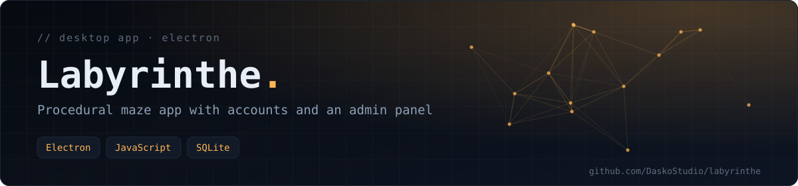
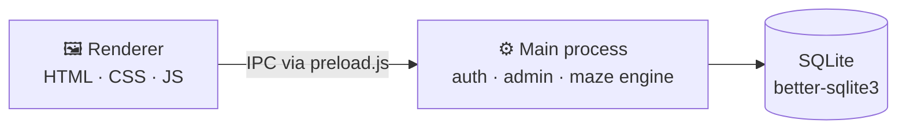

<div align="center">



**A desktop application to generate, explore and manage mazes: procedural generation across 10 difficulty levels, an interactive player view, user accounts, a personal dashboard and an admin panel.**

   

[About](#-about) · [Features](#-features) · [Technical architecture](#-technical-architecture) · [Getting started](#-getting-started) · [Tech stack](#-tech-stack)

</div>

## 📖 About

Labyrinthe is a JavaScript desktop app built on **Electron**. It combines procedural maze generation, an interactive exploration view and a complete user-management system. The generation algorithm adapts to the chosen difficulty level.

## ✨ Features

### 🎮 Players
- **Procedural generation** — every maze is unique.
- **10 difficulty levels** — from an easy stroll (level 1) to an extreme orientation challenge (level 10).
- **Interactive exploration** — smooth controls from the entrance to the exit.
- **Personal dashboard** — your statistics, your games and your solving times.

### ⚙️ Administration
- **Dedicated admin panel** for managing the platform.
- **User management** — view, edit and delete accounts.
- **Global statistics** — an overview of how the app is used.

### 🛡️ Security and system
- **Authentication** — sign-in and registration with session persistence.
- **Passwords hashed with bcrypt** (`bcryptjs`).
- **Electron isolation** — a `preload` script is the only bridge for inter-process communication (IPC).
- **Local persistence** — embedded SQLite database (`better-sqlite3`).

## 🏗️ Technical architecture



The project separates business logic, data access and user interface.

### Renderer process (frontend)
Plain HTML, CSS and JavaScript.
- `renderer/index.html` — the views (login, dashboard, editor, admin).
- `renderer/app.js` — client-side logic and IPC calls.
- `renderer/style.css` — styling.

### Main process (backend)
Node.js running inside Electron.
- `main.js` — application and window lifecycle.
- `auth.js` — authentication and sessions.
- `admin.js` — administration features.
- `preload.js` — secure bridge between renderer and main process.

### Maze engine
`labyrinth.js` implements different algorithms depending on difficulty:

| Levels | Algorithm |
|---|---|
| 1–3 | **Prim's algorithm** |
| 4–7 | **Recursive backtracker** |
| 8–10 | **Hybrid with complex dead ends** |

### Database
`database.js` wraps SQLite and stores users and scores synchronously.

## 🚀 Getting started

**Prerequisites:** Node.js 14+ and npm.

```bash
git clone https://github.com/DaskoStudio/labyrinthe.git
cd labyrinthe
npm install
npm start
```

If the native SQLite module does not match your Electron version, run `npm run rebuild`.

## 🗂️ Project structure

```text
labyrinthe/
├── package.json     Dependencies and npm scripts
├── main.js          Electron entry point (main process)
├── preload.js       Secure IPC bridge
├── labyrinth.js     Maze generation engine
├── auth.js          Authentication
├── admin.js         Admin panel logic
├── database.js      SQLite setup and queries
└── renderer/        User interface (index.html, app.js, style.css)
```

The database file `labyrinthe.db` is generated at first launch and is git-ignored.

## 🛡️ Security notes

- Passwords are hashed with bcrypt before being stored.
- On first launch the database is seeded with **demo accounts** (`admin` and `guest`). They exist for local testing only — change their passwords or remove them before any real use.

## 🛣️ Roadmap

- **Gameplay** — timer and a global scoreboard.
- **Content** — export (PNG/JSON) and import of custom mazes.
- **UI/UX** — dark, light and high-contrast themes.
- **Multiplayer** — a local-network "maze race" mode.

## 👥 Credits

Team project. The original repository is [Michi-esc/Labyrinthe](https://github.com/Michi-esc/Labyrinthe); this copy is kept here as part of my portfolio.

## 🧰 Tech stack

Electron · JavaScript (Node.js) · HTML/CSS · SQLite (`better-sqlite3`) · bcryptjs

---

<div align="center">

<sub>Built by <a href="https://github.com/DaskoStudio"><b>Konaté Adama</b></a> · <a href="https://github.com/DaskoStudio?tab=repositories">More projects</a></sub>

</div>
